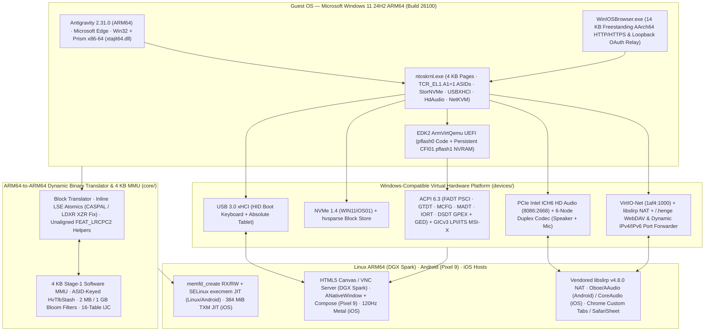

<div align="center">

# WindowsPixel

**Full Microsoft Windows 11 24H2 ARM64 running at near-native JIT speed on Linux ARM64 (NVIDIA DGX Spark) and Android (Google Pixel 9 / Tensor G4 & more) — without root or KVM.**  
*Forked from [`WindowsiOS`](https://github.com/ammaar/WindowsiOS) and adapted in two stages: **Stage A: DGX Spark (Linux ARM64 — Complete & Verified)** $\to$ **Stage B: Google Pixel 9 (Android 15/16 — Implemented & Linked, Ready for APK Build & Device Test)**.*

[](LICENSE)
[-0078D4.svg)](#porting-status-dgx-spark--pixel-9)
[](#system-architecture)
[](#porting-status-dgx-spark--pixel-9)

</div>

---

## Porting Status: DGX Spark $\to$ Pixel 9 (and ARM64 Android)

`WindowsPixel` adapts `WindowsiOS`'s custom ARM64-to-ARM64 dynamic binary translator and 4 KB software MMU from Apple Darwin/TXM to **standard Linux ARM64** and **non-rooted Android**:

| Target / Stage | Status | Highlights |
| :--- | :--- | :--- |
| **Stage A: NVIDIA DGX Spark (`spark-20aa`, Linux ARM64)** | **Complete & Verified** | Standalone `./build/winvm` ([`host/main_linux.c`](host/main_linux.c)), 24.000 MHz JIT counter scaling, `memfd_create` RX/RW JIT, built-in HTML5 Canvas (`--web 8080`), RFB 3.8 VNC (`--vnc 5900` with `DesktopSize` dynamic resize), pure-C PNG export, vendored `libslirp` v4.8.0 NAT. **Verified booting Windows 11 ARM64 (Build 26300) WinPE GUI across 4 vCPUs.** |
| **Stage B: Google Pixel 9 (Tensor G4, Android 15/16) & ARM64 Android** | **Implemented & Linked · Device Test Next** | `make android-lib` builds `build/android/libwinvm.{a,so}` and `libwinvm_jni.so` (NDK API 34, `-DHAVE_SLIRP=1`, Tensor G4 `cpus 4..7` pinning, SELinux `execmem` fallback, `MAP_NORESERVE` RAM, clean `hv_winvm_destroy()` restart teardown). Includes synchronized `ANativeWindow` + GLES 3.0 120 Hz blitter ([`devices/fb_android.c`](devices/fb_android.c)), AAudio full-duplex sound ([`host/audio_android.c`](host/audio_android.c)), JNI bridge ([`winvm_jni.c`](android/app/src/main/cpp/winvm_jni.c)), and Jetpack Compose + IME soft-keyboard + Chrome Custom Tabs OAuth UI ([`android/`](android/)). |
| **macOS & iOS (`WindowsiOS` upstream)** | **Preserved** | All `#ifdef __APPLE__` Metal, CoreAudio, TXM, and Xcode/iOS paths remain intact. |

See [`docs/pixel_9_porting_plan.md`](docs/pixel_9_porting_plan.md) and [`docs/android_toolchain_setup.md`](docs/android_toolchain_setup.md) for the full architecture review, Tensor G4 / Linux findings, and Stage B roadmap.

---

## Upstream Visual Showcase (`WindowsiOS`)

<table>
  <tr>
    <td align="center" width="50%">
      
      <br />
      <sub><b>Physical iPhone Duo (<code>iPhone19,4</code>):</b> Windows 11 24H2 ARM64 Desktop with native ARM64 <b>Antigravity 2.31.0</b>, full-duplex Intel HD Audio (Speaker + Mic), and active VirtIO Ethernet.</sub>
    </td>
    <td align="center" width="50%">
      
      <br />
      <sub><b>Antigravity 2.31.0 (Native Windows ARM64):</b> Multi-process Electron/Chromium IDE running live inside the 4 KB software-MMU ARM64-to-ARM64 JIT.</sub>
    </td>
  </tr>
  <tr>
    <td align="center" width="50%">
      
      <br />
      <sub><b>Physical iPhone Duo:</b> Unmodified ARM64 Microsoft Edge running with WHQL <code>NetKVM</code> VirtIO Ethernet over rootless <code>libslirp</code> NAT.</sub>
    </td>
    <td align="center" width="50%">
      
      <br />
      <sub><b>Live TLS 1.3 / HTTPS Web Rendering:</b> Microsoft Edge rendering Wikipedia over user-mode NAT with zero host entitlements.</sub>
    </td>
  </tr>
  <tr>
    <td align="center" colspan="2">
      
      <br />
      <sub><b>Native iOS <code>SafariSheet</code> OAuth Bridge:</b> <code>WinIOSBrowser.exe</code> registered as the <code>UCPD.sys</code>-verified default <code>HTTP</code>/<code>HTTPS</code> handler, relaying <code>localhost</code> OAuth callbacks between iOS <code>SFSafariViewController</code> (Passkeys / Face ID / Google sessions) and Windows apps.</sub>
    </td>
  </tr>
</table>

---

## What Didn't Exist Before This

Prior to `WindowsiOS`, booting and interactively using **unmodified retail Microsoft Windows 11 24H2 ARM64** (`Build 26100`) — complete with **Microsoft Edge**, **Antigravity `2.31.0`**, **Prism x86-64 emulation (`xtajit64.dll`)**, **full-duplex Speaker + Microphone audio**, and **passkey-capable Google OAuth** — at near-native speed on **non-jailbroken modern iOS** did not publicly exist:

1. **No Hardware Hypervisor on Stock iOS:** Apple restricted `com.apple.developer.kernel.hypervisor` (`Hypervisor.framework`) on stock iOS starting in iOS 16.4+, permanently cutting off hardware EL2 virtualization (`UTM HV`) on non-jailbroken iPhones and iPads. On iOS 26 and iOS 27 hardware (such as the A20 Pro), Apple's **Trusted Execution Monitor (TXM)** additionally enforces strict hardware page-table signing against arbitrary `MAP_JIT` execution.
2. **Interpreter Emulators Are 5–10× Too Slow for Windows 11 24H2:** Sideloaded and App Store emulators such as **UTM SE** fall back to QEMU's **TCG threaded interpreter** (`TCI`). Under interpretation, modern Windows 11 24H2 takes tens of minutes to reach the desktop and cannot interactively drive heavy multi-process Chromium/Electron stacks like Microsoft Edge or Antigravity.
3. **ARM64 Binary Translation Existed Only for macOS / Linux Guests — Not Windows NT:** [`Leviidev/Henge`](https://github.com/Leviidev/Henge) proved that an EL1&0 ARM64-to-ARM64 dynamic binary translator paired with a software MMU and TXM dual-mapped JIT could run macOS (`vmapple`, 16 KB pages) at near-native speed on modern iPhones. However, no open-source engine combined TXM ARM64-to-ARM64 JIT translation with everything the **Windows NT ARM64 kernel (`ntoskrnl.exe`)** demands:
   - Strict **4 KB stage-1 translation granules** (`TG0`/`TG1`) running on a 16 KB Darwin host;
   - Windows NT's **`TCR_EL1.A1 = 1`** ASID placement in `TTBR1_EL1[63:48]` and transient `ASID 0` transitions inside `KiSwapProcess`;
   - Windows 11's **Prism (`xtajit64.dll`)** unaligned `FEAT_LRCPC2` (`LDAPUR`/`STLUR`) memory ordering semantics (`SCTLR_EL1.nAA = 1`);
   - A full **UEFI + ACPI 6.3 + GICv3 LPI/ITS MSI-X + PCIe NVMe + USB 3.0 xHCI + Intel ICH6 HD Audio + WHQL VirtIO-Net** PC platform fitting comfortably inside iOS's Jetsam memory envelope.

---

## Standing on the Shoulders of Giants — Upstream Credits

`WindowsiOS` would not exist without the trailblazing open-source work of the iOS virtualization, binary-translation, and firmware communities. Full license notices and attributions are documented in [`THIRD_PARTY_NOTICES.md`](THIRD_PARTY_NOTICES.md):

- **[`Leviidev/Henge`](https://github.com/Leviidev/Henge) & [`Leviidev/Henge#7`](https://github.com/Leviidev/Henge/pull/7)** (`GPL-2.0-or-later`) — Foundational ARM64-to-ARM64 dynamic binary translator (`HengeVM`), stage-1 software MMU and indirect-branch/return cache design, multi-touch trackpad concepts, `/.henge/` WebDAV guest-host transport (`host/share.c`), and the iOS 26/27 TXM dual-mapped JIT substrate (`winios_jit.c`, `winios_brk.S`, `henge-jit.js`).
- **[`Leviidev/Husk`](https://github.com/Leviidev/Husk)** (`GPL-2.0-or-later`) — ARM64 binary translation architecture, iOS `libslirp` cross-compilation patches, and on-device JIT helper insights.
- **[`mxhm11cr/LinuxRunner`](https://github.com/mxhm11cr/LinuxRunner)** (building on [`ish-app/ish`](https://github.com/ish-app/ish) & [`rcarmo/ios-linuxkit`](https://github.com/rcarmo/ios-linuxkit)) — Early ARM64 guest OS bring-up patterns and iOS runtime/Jetsam discipline.
- **[`StephenDev0/StikDebug`](https://github.com/StephenDev0/StikDebug) / `StikJIT`** (`MPL-2.0` / `BSD-3-Clause`) & **[`jkcoxson/idevice`](https://github.com/jkcoxson/idevice)** (`MIT`) — On-device iOS 26/27 TXM debugger attachment, `universal.js` (`BRK #0x69` / `BRK #0xF00D`) RX/RW page-blessing, and `CS_DEBUGGED` ledger-exempt memory enablement.
- **[`libslirp`](https://gitlab.freedesktop.org/slirp/libslirp)** (`BSD-3-Clause`) — Rootless user-mode TCP/IP, DHCP, and DNS NAT stack (`host/net_slirp.c`).
- **[TianoCore EDK2 `ArmVirtQemu`](https://github.com/tianocore/edk2)** (`BSD-2-Clause-Patent`) — `AARCH64` UEFI firmware (`QEMU_EFI.fd`, fetched locally at provisioning time).
- **[Red Hat `virtio-win` (`NetKVM`)](https://github.com/virtio-win/kvm-guest-drivers-windows)** (`BSD-3-Clause` / `GPL-2.0`) — WHQL-signed Windows 11 ARM64 VirtIO Ethernet driver (fetched locally at provisioning time).

---

## System Architecture



---

## What Was Original & Hard — Built Here with Gemini 4 Carbon

Bringing unmodified Windows 11 24H2 ARM64 to full interactive life on a non-jailbroken foldable iPhone required solving a chain of deep OS kernel, ARMv8 architecture, PCIe/USB/HDA hardware, and iOS TXM memory problems. Every piece of this bring-up and engineering was built with **Gemini 4 Carbon**:

### 1. Windows NT 4 KB Software MMU & `TCR_EL1.A1 = 1` ASID-Keyed `HvTlbStash` ([`core/mmu.c`](core/mmu.c), [`core/cpu.h`](core/cpu.h), [`core/sysreg.c`](core/sysreg.c))
- **4 KB Granule & CPU Identity:** `ntoskrnl.exe` mandates 4 KB stage-1 translation granules (`HV_TLB_PAGE_BITS = 12`) and validates CPU identification and cycle counters during `KiInitializeKernel`. `core/sysreg.c` exposes an ARM Cortex-A76 r4p1 `MIDR_EL1` (`0x414fd0b1`), calibrated `PMCCNTR_EL0`, and 4-way per-privilege software TLB tables (`[EL0, EL1, EL1+PAN]` packed into single 128-byte cache lines so kernel `PAN` toggles around user copies never flush TLB state), paired with 2 MB and 1 GB large-block Bloom filters (`large_2m_bloom`, `large_big_bloom`) for fast range `TLBI`.
- **The `TCR_EL1.A1 = 1` & `KiSwapProcess` `ASID 0` Trap:** Unlike Linux and macOS (which store the user ASID in `TTBR0_EL1[63:48]`), **Windows 11 ARM64 sets `TCR_EL1.A1 = 1` (bit 22)**, placing the active process ASID in `TTBR1_EL1[63:48]`. Worse, during every context switch (`KiSwapProcess` — **64,800+ switches/sec** under desktop load), Windows writes the new `TTBR0_EL1` (`DirectoryTableBase`) while `TTBR1_EL1`'s ASID transiently transitions through **`ASID 0`**! Keying TLB stashes naively by `TTBR0` or stashing under `ASID 0` either thrashes every user TLB entry on every context switch or leaks stale user mappings across recycled physical `DirectoryTableBase` pages.
- **Solution:** `hv_mmu_ukey()` synthesizes a canonical `(ASID << 48) | (TTBR0 & OA_MASK)` address-space key reading the ASID from `TTBR1` whenever `TCR.A1 == 1` and explicitly returning `0` whenever `ASID == 0`. `HvTlbStash` (`hv_tlb_switch_user`) saves and restores ~266–313 live user TLB slots across context switches in microseconds without re-walking 4-level page tables.

### 2. Inline ARMv8.1 LSE Exclusive Atomics & the Clang `LDXR`/`LDAXR XZR` Bug ([`core/translate.c`](core/translate.c))
- **128-bit `SLIST` (`LDXP`/`STXP` → `LDP` + `CASPAL`):** The Windows NT dispatcher, heap, and I/O manager execute lock-free 128-bit `SLIST` operations (`ExpInterlockedPopEntrySList`) millions of times per second via `LDXP`/`LDAXP` and `STXP`/`STLXP`. Exiting to C on every pair-exclusive crippled boot performance; `translate_excl_pair()` lowers 64-bit and 128-bit exclusives directly into inline Apple Silicon `LDP` + ARMv8.1 LSE `CASPAL` fast paths.
- **The Subtle `rt == 31` (`LDXR XZR`) Deadlock/Corruption:** Clang-compiled C++ code inside Chromium (`msedge.dll`) and Electron (`Antigravity.exe`) frequently emits `ldxr xzr, [rn]; stlxr ws, xt, [rn]` (`rt == 31`) to arm the exclusive monitor without keeping the old value in a general-purpose register. In AArch64 machine code, register `31` encodes `XZR` in `LDXR` but encodes **`SP`** in `MOV`/`ADD` instructions — and if `HV_CPU_EXCL_VAL` is not populated with the true loaded memory word before checking `rt != 31`, either guest `SP` gets clobbered or `STLXR`'s `CASAL` compare-and-swap perpetually fails whenever `[rn] != 0`, deadlocking renderer threads. `translate_excl()` always loads into scratch `x6`, records `x6` into `HV_CPU_EXCL_VAL`, and suppresses register writeback when `rt == 31`.

### 3. Windows Prism (`xtajit64.dll`) Unaligned `FEAT_LRCPC2` Emulation ([`core/translate.c`](core/translate.c), [`core/memop.c`](core/memop.c))
- Windows 11 ARM64's **Prism** x86-64 binary translator (`xtajit64.dll`) executes with `SCTLR_EL1.nAA = 1` (non-aligned access permitted on Weakly-Ordered RCpc instructions) and emits unaligned **`LDAPUR` / `STLUR` / `LDAPR`** (`FEAT_LRCPC` / `FEAT_LRCPC2`) loads and stores to emulate x86-64 TSO memory ordering on packed x86 data structures.
- Darwin/XNU on Apple Silicon enforces **`SCTLR_EL1.nAA = 0`** in EL0 user space — executing a native `LDAPUR` or `STLUR` on an unaligned host address immediately kills the host process with **`SIGBUS` (`EXC_ARM_DA_ALIGN`)**.
- `translate_mem_impl()` enforces an inline alignment mask (`host_align`) on `HV_MEM_ORDERED` accesses: aligned RCpc instructions execute natively inline in 1 instruction (stripping `imm9` once `A` holds the effective host address), while unaligned accesses branch seamlessly out-of-line to acquire/release-fenced software helpers in `core/memop.c`.

### 4. Full Windows-Compatible Virtual Hardware Platform ([`devices/`](devices/))
Windows 11 24H2 refuses FDT/DeviceTree boot and demands a compliant ServerReady/PC-class UEFI + ACPI + MSI-X topology:
- **UEFI + Persistent CFI01 NVRAM ([`devices/pflash.c`](devices/pflash.c), [`devices/fw_cfg.c`](devices/fw_cfg.c), [`devices/fb_metal.m`](devices/fb_metal.m)):** Dual 64 MB flash banks (`pflash0` read-only `HvRam` code at `0x00000000` + `pflash1` persistent Intel CFI01 NVRAM at `0x04000000` so `bcdboot` `Boot0001` entries survive reboots) plus `ramfb` double-buffered 120 Hz Metal presentation.
- **Programmatic ACPI 6.3 + GICv3 ITS ([`devices/acpi.c`](devices/acpi.c), [`devices/gicv3.c`](devices/gicv3.c)):** Synthesizes `RSDP`, `XSDT`, `FADT` (HW-reduced ACPI + `PSCI` `HVC`), `GTDT`, `MCFG` (PCIe ECAM at `0x4010000000`), `MADT` (`GICD`, per-CPU `GICR`, and `GIC ITS` `0x0F` at `0x08080000`), **`IORT`** (mapping PCIe Root Complex RIDs `0x0000..0xFFFF` to `GICv3 ITS#0` so Windows arms MSI-X LPIs cleanly), and `DSDT` (`PNP0A08` GPEX Root Complex + `ACPI0013` GED power button).
- **NVMe 1.4 + `USBXHCI.SYS`-Compliant USB 3.0 xHCI + WHQL `virtio-net` ([`devices/nvme.c`](devices/nvme.c), [`devices/xhci.c`](devices/xhci.c), [`devices/virtio_net.c`](devices/virtio_net.c)):**
  - PCIe endpoints advertise **Root Complex Integrated Endpoint (`0x0092`)** capabilities so `pci.sys` accepts bus-0 devices without root ports.
  - `nvme.c` implements admin/I/O queues, PRP lists, MSI-X, serial `WIN11IOS01`, and deferred flush synchronization (`hv_disk_sync()`) so NTFS metadata bursts don't stall iOS flash storage.
  - `xhci.c` implements **Event Data TRB (`ED = 1`) cumulative transfer-length tracking (`EDTLA`)** and `CC_STALL` endpoint-halt recovery strictly required by Windows's `USBXHCI.SYS`, exposing Port 1 Boot Keyboard (`0627:0002`) and Port 2 Absolute Touch/Trackpad Tablet (`0627:0001`).

### 5. From-Scratch PCIe Intel ICH6 Full-Duplex HD Audio ([`devices/hda.c`](devices/hda.c), [`host/audio_mac.c`](host/audio_mac.c))
- Red Hat's `virtio-win` suite has **no** Windows `virtio-snd` driver. To achieve zero-driver-install plug-and-play audio in Windows 11 ARM64, we built a complete **Intel ICH6 High Definition Audio PCIe controller (`8086:2668`, `PCI\CC_0403`)** from scratch in `devices/hda.c` paired with a 6-node Full-Duplex HDA Codec (`1af4:0022`):
  - `NID 0` Root → `NID 1` Audio Function Group → `NID 2` Stereo DAC + `NID 3` Speakers Pin Complex (`0x01114010`) + `NID 4` Stereo ADC + `NID 5` Microphone Pin Complex (`0x01a19020`).
  - Full CORB/RIRB verb ring engines, 24.000 MHz `WALCLK`, DMA Position Buffer (`DPLBASE`/`DPUBASE`), `LPIB`, and scatter-gather BDL streams.
- Windows 11 binds inbox `hdaudbus.sys` + `HdAudio.sys` automatically on first boot, streaming lock-free 48 kHz S16LE playback to iOS `RemoteIO` (`AudioUnit`) and live microphone capture from iOS `AudioQueueNewInput` (`AVAudioSessionCategoryPlayAndRecord`).

### 6. 384 MiB TXM Dual-Mapped JIT + 4.5 GB Ledger-Exempt RAM + Featherweight Windows 11 ([`ios/Sources/Native/winios_jit.c`](ios/Sources/Native/winios_jit.c), [`tools/opt_hive_arm64.c`](tools/opt_hive_arm64.c), [`scripts/optimize_windows_lite.py`](scripts/optimize_windows_lite.py))
- **TXM Low-VA Reservation & Ledger-Exempt RAM:** On iOS 26/27 TXM devices, executable JIT mappings placed above `0x7000000000` hang in hardware. `winios_jit.c` reserves a static zero-fill region in `__DATA` below `0x180000000` at Mach-O load time, releases it right before `debugserver` `_M<size>,rx` allocation to claim a **384 MiB RX/RW dual-mapped JIT**, and uses `mach_make_memory_entry_64` + `mach_memory_entry_ownership(..., LEDGER_NO_FOOTPRINT)` (`hv_alloc_no_footprint`) while `CS_DEBUGGED` is active to pre-allocate **4,608 MiB (4.5 GB) of Jetsam-exempt Guest RAM** before LLDB detaches — leaving **~2–3 GB of free iOS Jetsam headroom**.
- **Featherweight Offline Hive Surgery (`1.46 GB` Idle RAM):** Using an offline WinPE environment plus a custom freestanding ARM64 Win32 tool (`tools/opt_hive_arm64.c`, opening `SYSTEM`/`SOFTWARE` hives with `SeBackupPrivilege` + `SeRestorePrivilege` + `REG_OPTION_BACKUP_RESTORE` to bypass `TrustedInstaller` DACLs cleanly), `optimize_windows_lite.py` strips 35+ background UWP/telemetry/Defender/indexer hogs and KVA Shadow overhead — bringing Windows 11 24H2 idle desktop memory down to **`1.46 GB / 4.5 GB` (`~31.7%`)** and **`89%` WFI idle** across 4 A20 Pro performance-core vCPUs, packed into a compact `hvsparse` block image (`host/hvsparse.c`).

### 7. Foldable iPhone Duo Surface Laptop Ultra UI + Native iOS `SafariSheet` OAuth Bridge ([`ios/Sources/`](ios/Sources/), [`tools/winios_browser_arm64.c`](tools/winios_browser_arm64.c))
- **Posture-Aware Foldable UI:** Hooks iOS 27's `UIHingeInteraction` (`HingeSensorView.swift`) on the foldable iPhone Duo to transition fluidly between:
  - **Folded Clamshell Laptop Mode:** Top 50% razor-bezel Obsidian-Glass Metal display lid (with Studio camera indicator and coordinate-snapping XAML double-tap) + bottom 50% Midnight-Sapphire CNC deck housing a 6-row chiclet keyboard (`F1–F10`, Copilot key, stacked `Up`/`Down` arrows) and a 120 Hz haptic matte-glass multi-touch trackpad (`LaptopDeckView.swift`).
  - **Unfolded Open Studio Mode:** Edge-to-edge full-screen Windows 11 tablet/desktop canvas with an auto-hiding frosted-sapphire command pill (`SessionView.swift`).
- **Seamless Google / Passkey OAuth Loopback Relay:** Signing into desktop IDEs like **Antigravity `2.31.0`** opens an OAuth URL whose `redirect_uri` points to an ephemeral `http://localhost:<PORT>/oauth-callback` listener inside Windows. Clicking **"Continue with Google"** invokes `WinIOSBrowser.exe` (`tools/winios_browser_arm64.c` — a 14 KB freestanding `AArch64` Win32 executable registered as `WinIOSHTML` / `MSEdgeHTM`), which:
  1. Parses single- or double-URL-encoded `localhost:<PORT>` / `127.0.0.1:<PORT>` redirect URIs;
  2. Spawns a guest TCP relay (`10.0.2.15:<PORT> ↔ 127.0.0.1:<PORT>`) and calls `PUT http://10.0.2.4/.henge/expose-port` so `host/net_slirp.c` binds dual-stack iOS `127.0.0.1:<PORT>` and `[::1]:<PORT>` forwards into the guest;
  3. Calls `PUT http://10.0.2.4/.henge/open-url` to pop up iOS's native **`SFSafariViewController`** (`SafariSheet`) — giving instant access to the user's existing iOS Safari Google session, Passkeys, and Face ID — and signals `/.henge/oauth-done` to auto-dismiss the sheet with haptic confirmation the moment the token lands back in Windows! (Includes a 1-tap `OAuth: Safari` / `OAuth: Edge` toggle in the Studio bar.)

---

## Virtual Machine Physical Memory Map & PCIe Topology

| Guest Physical Address | Size | Device / Subsystem | Implementation |
| :--- | :--- | :--- | :--- |
| `0x0000_0000` | `64 MiB` | `pflash0` — EDK2 `ArmVirtQemu` UEFI Code (Read-Only `HvRam`) | [`devices/pflash.c`](devices/pflash.c) |
| `0x0400_0000` | `64 MiB` | `pflash1` — Persistent Intel CFI01 UEFI Variable Store (`vars.fd`) | [`devices/pflash.c`](devices/pflash.c) |
| `0x0800_0000` | `64 KiB` | ARM GICv3 Distributor (`GICD`) | [`devices/gicv3.c`](devices/gicv3.c) |
| `0x0808_0000` | `128 KiB` | ARM GICv3 Interrupt Translation Service (`GIC ITS#0`, LPI MSI-X) | [`devices/gicv3.c`](devices/gicv3.c) |
| `0x080A_0000` | `15 MiB` | ARM GICv3 Per-vCPU Redistributors (`GICR`) | [`devices/gicv3.c`](devices/gicv3.c) |
| `0x0900_0000` | `64 KiB` | PrimeCell `PL011` UART, `PL031` RTC (`0x09010000`), `fw_cfg` + `ramfb` (`0x09020000`), `PL061` GPIO (`0x09030000`), ACPI GED (`0x09080000`) | [`devices/winvirt.c`](devices/winvirt.c) |
| `0x1000_0000` | `752 MiB` | PCIe 32-bit MMIO Window + PIO (`0x3EFF0000`) | [`devices/pcie.c`](devices/pcie.c) |
| `0x4000_0000` | `4.5 GiB` | Guest System DRAM (`hv_alloc_no_footprint` on iOS) | [`devices/winvirt.c`](devices/winvirt.c) |
| `0x40_1000_0000` | `256 MiB` | PCIe ECAM Configuration Space (`MCFG`) | [`devices/pcie.c`](devices/pcie.c) |
| `0x80_0000_0000` | `512 GiB` | PCIe 64-bit High MMIO BAR Window | [`devices/pcie.c`](devices/pcie.c) |

**PCIe GPEX Bus `00` Endpoints:**
- `00:00.0` — Red Hat GPEX Host Bridge (`1b36:0008`)
- `00:01.0` — VirtIO Network Adapter (`1af4:1000`, WHQL `NetKVM` over `libslirp` NAT + `/.henge/` WebDAV/OAuth)
- `00:02.0` — NVMe 1.4 Controller (`1b36:0010`, Serial `WIN11IOS01`, MSI-X + `hvsparse` backing)
- `00:03.0` — USB 3.0 xHCI Host Controller (`1b36:000d`, Port 1 HID Boot Keyboard + Port 2 Absolute Tablet)
- `00:04.0` — Intel ICH6 High Definition Audio (`8086:2668`, Codec `1af4:0022` Stereo Speaker Out + Stereo Mic In)

---

## Building, Provisioning & Running

> **Note:** No disk images (`*.img`, `*.hvsparse`), UEFI firmware binaries (`*.fd`), or Windows/driver ISOs (`*.esd`, `*.iso`, `*.exe`) are stored in git. All large artifacts live exclusively inside `work/` and `build/` (enforced by [`.gitignore`](.gitignore)).

### A. Linux ARM64 (NVIDIA DGX Spark `spark-20aa`)
```bash
# 1. Build core engine, unit tests, hvsparse, and standalone Linux runner (with embedded libslirp)
make -j8 && make test-core

# 2. If connecting over SSH, forward the built-in web viewer (:8080) and/or VNC (:5900) ports from your local machine:
ssh -N -L 8080:localhost:8080 -L 5900:localhost:5900 <user>@<spark-host>

# 3. First-time provisioning (reset vars.fd once if UEFI has a stale BootOrder):
dd if=/dev/zero of=work/vars.fd bs=1M count=64 status=none
./build/winvm \
  --code work/code.fd --vars work/vars.fd \
  --disk work/windows11.img --disk1 work/installer.img \
  --cpus 4 --ram 4608 --web 8080 --vnc 5900

# 4. (Optional, one-time) Install Red Hat virtio-win NetKVM driver for internet access:
./build/winvm \
  --code work/code.fd --vars work/vars.fd \
  --disk work/windows11.img --disk1 work/virtio_net.img \
  --cpus 4 --ram 4608 --web 8080 --vnc 5900
# Inside Windows (Admin terminal): pnputil /add-driver D:\NetKVM\w11\ARM64\*.inf /install

# 5. Boot installed Windows 11 (drop --disk1 and keep vars.fd):
./build/winvm \
  --code work/code.fd --vars work/vars.fd \
  --disk work/windows11.img \
  --cpus 4 --ram 4608 --web 8080 --vnc 5900
```
Open **`http://localhost:8080`** in your local browser (or connect a VNC client to `localhost:5900`).
> **Note on `WINPE` installer drive letters:** If `installer.img` uses a GPT EFI System Partition (`EF00`), WinPE intentionally does not auto-assign it a drive letter (`no ltr`). If `startnet.cmd` stops with `no path found`, run `(echo select volume 2 & echo assign letter=I) | diskpart` and then `X:\Windows\System32\startnet.cmd`.

### B. Android ARM64 (Google Pixel 9 / Tensor G4 & Android 15/16)
```bash
# 1. (Optional on Linux ARM64 host) Verify native + JNI library cross-compilation:
make android-lib -j8
# Output: build/android/libwinvm.a, build/android/libwinvm.so, build/android/libwinvm_jni.so

# 2. Build & install the Android APK:
#    On macOS / x86_64 PC (or Android Studio):
cd android && ./gradlew installDebug

#    Or directly on Linux ARM64 (spark-20aa) using prebuilt JNI + native ARM64 aapt2:
mkdir -p android/app/src/main/jniLibs/arm64-v8a
cp build/android/libwinvm_jni.so android/app/src/main/jniLibs/arm64-v8a/
cd android && ./gradlew assembleDebug -PusePrebuiltJni=true -Pandroid.aapt2FromMavenOverride="$HOME/.local/bin/aapt2"
adb install -r app/build/outputs/apk/debug/app-debug.apk

# 3. Push your provisioned UEFI + Windows 11 images to the Pixel 9:
#    (Optional) Pack windows11.img into a compact zero-skipping .hvsparse file first:
./build/hvsparse pack work/windows11.img work/windows11.hvsparse
adb push work/code.fd work/vars.fd work/windows11.hvsparse /sdcard/Android/data/com.winpixel.app/files/Machines/Win11/
```
4. Launch **WindowsPixel** on your Pixel 9, grant microphone permission if prompted, adjust vCPUs/RAM (`4 vCPUs`, `4096 MB`), and tap **Boot Windows 11 ARM64**.
   * Use the top floating pill to switch between **Touch** (direct tap/drag) and **Trackpad** (relative cursor), open the **Keyboard**, send **Ctrl+Alt+Del**, or cleanly **Power** off Windows.

### C. macOS & iOS (Upstream `WindowsiOS` Build)
- macOS on Apple Silicon (`M1` or newer; developed on M5 Pro) with Xcode, `xcodegen`, `meson`, `ninja`, `pkg-config`, `libslirp`, `llvm`/`lld` (for compiling freestanding `AArch64` Win32 guest helpers), and Python 3.
- An official Microsoft **Windows 11 24H2 ARM64** retail ESD placed at `work/downloads/Win11_24H2_ARM64_en-us.esd`, EDK2 `QEMU_EFI.fd` at `work/code.fd`, and WHQL `virtio-win` `NetKVM` (`w11/ARM64`) drivers.

### 1. Build Engine, Unit Tests, macOS Runner & iOS Static Archive
```bash
# Cross-compile libffi + glib + libslirp for arm64-apple-ios into ios/deps/
./scripts/build_ios_deps.sh

# Build macOS host VM (build/winvm), sparse packer (build/hvsparse), iOS library (build/ios/libwinvm.a), and run core JIT/MMU tests
make -j8 all ios-lib test-core
```

### 2. Provision & Optimize Featherweight Windows 11 24H2 ARM64 Image
```bash
# Unattended WinPE DISM + NetKVM injection + BCDBOOT UEFI NVRAM provisioning -> work/windows11.img + work/vars.fd
/opt/homebrew/bin/python3 scripts/provision_windows_arm64.py

# Offline WinPE DISM bloat removal + SeRestorePrivilege registry hive surgery -> work/windows11_lite.img (1.46 GB idle RAM)
/opt/homebrew/bin/python3 scripts/optimize_windows_lite.py

# Pack into fast zero-skipping sparse container for iOS transfer -> work/windows11.hvsparse
./build/hvsparse pack work/windows11_lite.img work/windows11.hvsparse
```

### 3. Run Locally on macOS (`build/winvm`)
```bash
HV_OAUTH_BRIDGE=1 ./build/winvm \
  --cpus 4 --ram 4608 \
  --bios work/code.fd --vars work/vars.fd \
  --disk work/windows11_lite.img
```

### 4. Build, Install & Launch on Physical iOS 26/27 TXM Hardware (iPhone Duo)
```bash
# Generate Xcode project from ios/project.yml and build Release iphoneos bundle
xcodegen generate --spec ios/project.yml
xcodebuild -project ios/WindowsiOS.xcodeproj -scheme WindowsiOS -configuration Release \
  -sdk iphoneos -derivedDataPath build/DerivedData build

# Install WindowsiOS.app and copy work/windows11.hvsparse + code.fd + vars.fd to Documents/Machines/Win11,
# then launch --start-stopped, bless 384 MiB TXM JIT + 4,608 MiB ledger-exempt RAM via LLDB, and detach cleanly:
xcrun devicectl device install app --device <DEVICE_UDID> \
  build/DerivedData/Build/Products/Release-iphoneos/WindowsiOS.app
./scripts/launch_on_duo.sh <DEVICE_UDID> me.ammaar.windowsios
```

---

## Repository Layout

```text
WindowsPixel/
├── core/         # ARM64-to-ARM64 JIT compiler, 4 KB stage-1 MMU, 24 MHz counter scaling, ASID HvTlbStash, LSE/LRCPC2 helpers
├── devices/      # UEFI pflash, ACPI 6.3, GICv3 + ITS, PCIe GPEX, NVMe 1.4, USB 3.0 xHCI, Intel HDA, VirtIO-Net, ramfb + PNG/Metal
├── host/         # Entry assembly (enter.S), Linux/Android/macOS runners (main_linux.c, main_mac.m), memfd/TXM JIT, libslirp NAT, share, hvsparse
├── third_party/  # Self-contained vendored libslirp v4.8.0 + glib.h compatibility shim (zero external deps on Linux/Android)
├── docs/         # Two-stage DGX Spark -> Pixel 9 porting plan, technical review, Android NDK setup, and upstream showcase images
├── ios/          # SwiftUI + UIKit iPhone Duo app (upstream WindowsiOS)
├── scripts/      # Automated iOS dep builder, Windows 11 ARM64 ESD provisioner, Featherweight hive optimizer, and LLDB TXM launcher
├── tools/        # hvsparse CLI, freestanding ARM64 WinPE hive surgery (opt_hive_arm64.c), and WinIOSBrowser.exe OAuth relay (winios_browser_arm64.c)
├── tests/        # Dual Mach-O/ELF unit test suites (classify, jit_region, operands, jit, mem, mmu, exc, bench)
├── CMakeLists.txt
├── LICENSE       # GNU General Public License v2.0 or later (GPL-2.0-or-later)
└── THIRD_PARTY_NOTICES.md
```

---

## License

`WindowsPixel` (forked from `WindowsiOS`) is free software licensed under the **GNU General Public License v2.0 or later** (`GPL-2.0-or-later`). See [`LICENSE`](LICENSE) for the full license text and [`THIRD_PARTY_NOTICES.md`](THIRD_PARTY_NOTICES.md) for complete upstream attributions and third-party license notices.
