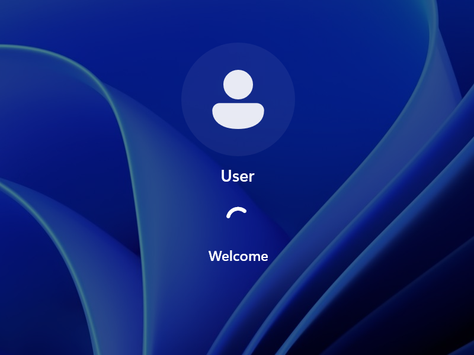
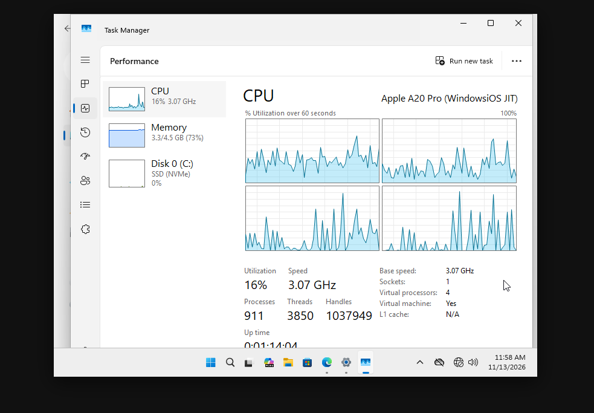
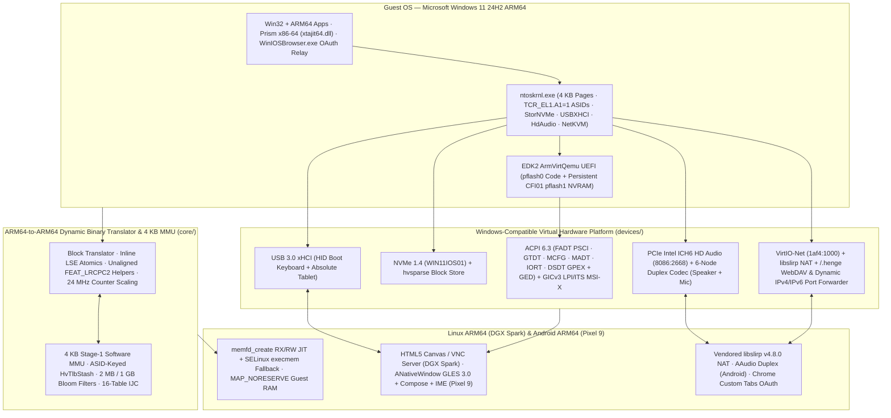

<div align="center">

# WindowsPixel

**Full Microsoft Windows 11 24H2 ARM64 running at near-native JIT speed on Linux ARM64 (NVIDIA DGX Spark) and Android (Google Pixel 9 / Tensor G4 & more) — without root or KVM.**  
*Forked from [`WindowsiOS`](https://github.com/ammaar/WindowsiOS) and adapted in two stages: **Stage A: DGX Spark (Linux ARM64 — Complete & Verified)** $\to$ **Stage B: Google Pixel 9 (Android 15/16 — Implemented, Native Libs & Debug APK Built, Ready for Device Test)**.*

[](LICENSE)
[-0078D4.svg)](#porting-status-dgx-spark--pixel-9)
[](#system-architecture)
[](#porting-status-dgx-spark--pixel-9)

</div>

---

## Porting Status: DGX Spark $\to$ Pixel 9 (and ARM64 Android)

`WindowsPixel` adapts `WindowsiOS`'s custom ARM64-to-ARM64 dynamic binary translator and 4 KB software MMU from Apple Darwin/TXM to **standard Linux ARM64** and **non-rooted Android**:

| Target / Stage | Status | Highlights |
| :--- | :--- | :--- |
| **Stage A: NVIDIA DGX Spark (`spark-20aa`, Linux ARM64)** | **Complete & Verified** | Standalone `./build/winvm` ([`host/main_linux.c`](host/main_linux.c)), 24.000 MHz JIT counter scaling, `memfd_create` RX/RW JIT, built-in HTML5 Canvas (`--web 8080`), RFB 3.8 VNC (`--vnc 5900` with `DesktopSize` dynamic resize), pure-C PNG export (`--screenshot`), and vendored `libslirp` v4.8.0 NAT. **Verified booting Windows 11 ARM64 across 4 vCPUs.** |
| **Stage B: Google Pixel 9 (Tensor G4, Android 15/16) & ARM64 Android** | **APK Built · Device Test Next** | `make android-lib` builds `build/android/libwinvm.{a,so}` and `libwinvm_jni.so` (NDK API 34, `-DHAVE_SLIRP=1`, Tensor G4 `cpus 4..7` pinning, SELinux `execmem` fallback, `MAP_NORESERVE` RAM, clean `hv_winvm_destroy()` restart teardown). Includes synchronized `ANativeWindow` + GLES 3.0 120 Hz blitter ([`devices/fb_android.c`](devices/fb_android.c)), AAudio full-duplex sound ([`host/audio_android.c`](host/audio_android.c)), JNI bridge ([`winvm_jni.c`](android/app/src/main/cpp/winvm_jni.c)), and Jetpack Compose + IME soft-keyboard + Chrome Custom Tabs OAuth UI ([`android/`](android/)). |

See [`docs/pixel_9_porting_plan.md`](docs/pixel_9_porting_plan.md), [`docs/android_toolchain_setup.md`](docs/android_toolchain_setup.md), and [`docs/technical_discussion_review.md`](docs/technical_discussion_review.md) for the full architecture review, Tensor G4 / Linux findings, and toolchain setup.

---

## Runtime Showcase (NVIDIA DGX Spark `spark-20aa`)

<table>
  <tr>
    <td align="center" width="50%">
      
      <br />
      <sub><b>DGX Spark (45s from cold UEFI boot):</b> Windows 11 ARM64 User Welcome screen across 4 vCPUs via <code>./build/winvm --headless --screenshot ...</code>.</sub>
    </td>
    <td align="center" width="50%">
      
      <br />
      <sub><b>DGX Spark Desktop & Task Manager:</b> Live Windows 11 ARM64 running across 4 vCPUs, 4.5 GB RAM, and NVMe storage via the built-in web viewer.</sub>
    </td>
  </tr>
</table>

---

## System Architecture



---

## Key Linux & Android Porting Highlights

- **Dual Mach-O / ELF Assembly & 24.000 MHz Counter Scaling ([`host/enter.S`](host/enter.S), [`core/sysreg.c`](core/sysreg.c), [`core/translate.c`](core/translate.c)):** Replaced Darwin commpage reads with `cntvct_el0` scaled to exact 24.000 MHz ticks via 60-bit fixed-point 128-bit multiplication (`mul` + `umulh` + `extr #60`), and disabled `ShadowCallStack` (`-fno-sanitize=shadow-call-stack`) on Android so `x18` stays available for Windows TEB / JIT use.
- **SELinux-Safe Dual-Mapped JIT & Big.LITTLE Pinning ([`host/jit_region.c`](host/jit_region.c), [`host/winvm.c`](host/winvm.c)):** Uses `memfd_create` (`RX` + `RW` views) with automatic anonymous `PROT_READ | PROT_WRITE | PROT_EXEC` fallback if SELinux blocks `PROT_EXEC` on `memfd`, plus `sched_setaffinity()` pinning vCPU threads to `cpus 4..7` (Cortex-X4 + A720) on Tensor G4.
- **Self-Contained `libslirp` v4.8.0 & `ramfb` Display ([`third_party/libslirp/`](third_party/libslirp/), [`devices/fb_display.c`](devices/fb_display.c), [`devices/fb_android.c`](devices/fb_android.c)):** Zero external dependencies on Linux/Android; `fb_android.c` blits `BGRX8888` directly using `GL_TEXTURE_SWIZZLE_R/B/A` with synchronized `surfaceDestroyed` teardown, and `host/main_linux.c` provides an HTTP/Canvas viewer (`--web`), VNC server (`--vnc`), and pure-C PNG export (`--screenshot`).

---

## Virtual Machine Physical Memory Map & PCIe Topology

| Guest Physical Address | Size | Device / Subsystem | Implementation |
| :--- | :--- | :--- | :--- |
| `0x0000_0000` | `64 MiB` | `pflash0` — EDK2 `ArmVirtQemu` UEFI Code (Read-Only `HvRam`) | [`devices/pflash.c`](devices/pflash.c) |
| `0x0400_0000` | `64 MiB` | `pflash1` — Persistent Intel CFI01 UEFI Variable Store (`vars.fd`) | [`devices/pflash.c`](devices/pflash.c) |
| `0x0800_0000` | `64 KiB` | ARM GICv3 Distributor (`GICD`) | [`devices/gicv3.c`](devices/gicv3.c) |
| `0x0808_0000` | `128 KiB` | ARM GICv3 Interrupt Translation Service (`GIC ITS#0`, LPI MSI-X) | [`devices/gicv3.c`](devices/gicv3.c) |
| `0x080A_0000` | `15 MiB` | ARM GICv3 Per-vCPU Redistributors (`GICR`) | [`devices/gicv3.c`](devices/gicv3.c) |
| `0x0900_0000` | `64 KiB` | PrimeCell `PL011` UART, `PL031` RTC (`0x09010000`), `fw_cfg` + `ramfb` (`0x09020000`), `PL061` GPIO (`0x09030000`), ACPI GED (`0x09080000`) | [`devices/winvirt.c`](devices/winvirt.c) |
| `0x1000_0000` | `752 MiB` | PCIe 32-bit MMIO Window + PIO (`0x3EFF0000`) | [`devices/pcie.c`](devices/pcie.c) |
| `0x4000_0000` | `4.5 GiB` | Guest System DRAM (`MAP_NORESERVE` + `MADV_HUGEPAGE`) | [`devices/winvirt.c`](devices/winvirt.c) |
| `0x40_1000_0000` | `256 MiB` | PCIe ECAM Configuration Space (`MCFG`) | [`devices/pcie.c`](devices/pcie.c) |
| `0x80_0000_0000` | `512 GiB` | PCIe 64-bit High MMIO BAR Window | [`devices/pcie.c`](devices/pcie.c) |

**PCIe GPEX Bus `00` Endpoints:**
- `00:00.0` — Red Hat GPEX Host Bridge (`1b36:0008`)
- `00:01.0` — VirtIO Network Adapter (`1af4:1000`, WHQL `NetKVM` over `libslirp` NAT + `/.henge/` WebDAV/OAuth)
- `00:02.0` — NVMe 1.4 Controller (`1b36:0010`, Serial `WIN11IOS01`, MSI-X + `hvsparse` backing)
- `00:03.0` — USB 3.0 xHCI Host Controller (`1b36:000d`, Port 1 HID Boot Keyboard + Port 2 Absolute Tablet)
- `00:04.0` — Intel ICH6 High Definition Audio (`8086:2668`, Codec `1af4:0022` Stereo Speaker Out + Stereo Mic In)

---

## Building, Provisioning & Running

> **Note:** No disk images (`*.img`, `*.hvsparse`), UEFI firmware binaries (`*.fd`), or Windows/driver ISOs (`*.esd`, `*.iso`, `*.exe`) are stored in git. All large artifacts live exclusively inside `work/` and `build/` (enforced by [`.gitignore`](.gitignore)).

### A. Linux ARM64 (NVIDIA DGX Spark `spark-20aa`)
```bash
# 1. Build core engine, unit tests, hvsparse, and standalone Linux runner (with embedded libslirp)
make -j8 && make test-core

# 2. If connecting over SSH, forward the built-in web viewer (:8080) and/or VNC (:5900) ports from your local machine:
ssh -N -L 8080:localhost:8080 -L 5900:localhost:5900 <user>@<spark-host>

# 3. First-time provisioning (reset vars.fd once if UEFI has a stale BootOrder):
dd if=/dev/zero of=work/vars.fd bs=1M count=64 status=none
./build/winvm \
  --code work/code.fd --vars work/vars.fd \
  --disk work/windows11.img --disk1 work/installer.img \
  --cpus 4 --ram 4608 --web 8080 --vnc 5900

# 4. (Optional, one-time) Install Red Hat virtio-win NetKVM driver for internet access:
./build/winvm \
  --code work/code.fd --vars work/vars.fd \
  --disk work/windows11.img --disk1 work/virtio_net.img \
  --cpus 4 --ram 4608 --web 8080 --vnc 5900
# Inside Windows (Admin terminal): pnputil /add-driver D:\NetKVM\w11\ARM64\*.inf /install

# 5. Boot installed Windows 11 (drop --disk1 and keep vars.fd):
./scripts/launch_spark.sh
# Equivalent manual command:
# ./build/winvm \
#   --code work/code.fd --vars work/vars.fd \
#   --disk work/windows11.img \
#   --cpus 8 --ram 8608 --web 8080 --vnc 5900
```
Open **`http://localhost:8080`** in your local browser (or connect a VNC client to `localhost:5900`).
> **Note on `WINPE` installer drive letters:** If `installer.img` uses a GPT EFI System Partition (`EF00`), WinPE intentionally does not auto-assign it a drive letter (`no ltr`). If `startnet.cmd` stops with `no path found`, run `(echo select volume 2 & echo assign letter=I) | diskpart` and then `X:\Windows\System32\startnet.cmd`.

### B. Android ARM64 (Google Pixel 9 / Tensor G4 & Android 15/16)
```bash
# 1. Cross-compile native + JNI libraries on Linux ARM64 host:
make android-lib -j8
# Output: build/android/libwinvm.a, build/android/libwinvm.so, build/android/libwinvm_jni.so

# 2. Build & install the Android APK:
#    On macOS / x86_64 PC (or Android Studio):
cd android && ./gradlew installDebug

#    Or directly on Linux ARM64 (spark-20aa) using prebuilt JNI + native ARM64 aapt2:
mkdir -p android/app/src/main/jniLibs/arm64-v8a
cp build/android/libwinvm_jni.so android/app/src/main/jniLibs/arm64-v8a/
cd android && ./gradlew assembleDebug -PusePrebuiltJni=true -Pandroid.aapt2FromMavenOverride="$HOME/.local/bin/aapt2"
adb install -r app/build/outputs/apk/debug/app-debug.apk

# 3. Push your provisioned UEFI + Windows 11 images to the Pixel 9:
#    (Optional) Pack windows11.img into a compact zero-skipping .hvsparse file first:
./build/hvsparse pack work/windows11.img work/windows11.hvsparse
adb push work/code.fd work/vars.fd work/windows11.hvsparse /sdcard/Android/data/com.winpixel.app/files/Machines/Win11/
```
4. Launch **WindowsPixel** on your Pixel 9, grant microphone permission if prompted, adjust vCPUs/RAM (`4 vCPUs`, `4096 MB`), and tap **Boot Windows 11 ARM64**.
   * Use the top floating pill to switch between **Touch** (direct tap/drag) and **Trackpad** (relative cursor), open the **Keyboard** (supports Android IME + hardware keys), send **Ctrl+Alt+Del**, or cleanly **Power** off / **Stop** Windows.

---

## Repository Layout

```text
WindowsPixel/
├── core/         # ARM64-to-ARM64 JIT compiler, 4 KB stage-1 MMU, 24 MHz counter scaling, ASID HvTlbStash, LSE/LRCPC2 helpers
├── devices/      # UEFI pflash, ACPI 6.3, GICv3 + ITS, PCIe GPEX, NVMe 1.4, USB 3.0 xHCI, Intel HDA, VirtIO-Net, ramfb + PNG/GLES
├── host/         # Entry assembly (enter.S), Linux/Android/macOS runners, memfd JIT, libslirp NAT, share, hvsparse, audio_android
├── android/      # Jetpack Compose Pixel 9 app, VmForegroundService, JNI bridge (winvm_jni.c), Gradle build
├── third_party/  # Self-contained vendored libslirp v4.8.0 + glib.h compatibility shim (zero external deps on Linux/Android)
├── docs/         # Porting plan, technical review, Android NDK/APK setup, and DGX Spark runtime captures
├── scripts/      # Automated Windows 11 ARM64 ESD provisioner, Featherweight hive optimizer, and helper scripts
├── tools/        # hvsparse CLI, freestanding ARM64 WinPE hive surgery (opt_hive_arm64.c), and OAuth relay (winios_browser_arm64.c)
├── tests/        # Dual Mach-O/ELF unit test suites (classify, jit_region, operands, jit, mem, mmu, exc, bench)
├── CMakeLists.txt
├── LICENSE       # GNU General Public License v2.0 or later (GPL-2.0-or-later)
└── THIRD_PARTY_NOTICES.md
```

---

## Upstream Credits & License

`WindowsPixel` is forked from [`WindowsiOS`](https://github.com/ammaar/WindowsiOS), which builds upon [`Leviidev/Henge`](https://github.com/Leviidev/Henge), [`Leviidev/Husk`](https://github.com/Leviidev/Husk), [`libslirp`](https://gitlab.freedesktop.org/slirp/libslirp), TianoCore EDK2 `ArmVirtQemu`, and Red Hat `virtio-win` (`NetKVM`).  
Licensed under the **GNU General Public License v2.0 or later** (`GPL-2.0-or-later`) — see [`LICENSE`](LICENSE) and [`THIRD_PARTY_NOTICES.md`](THIRD_PARTY_NOTICES.md) for full details.
