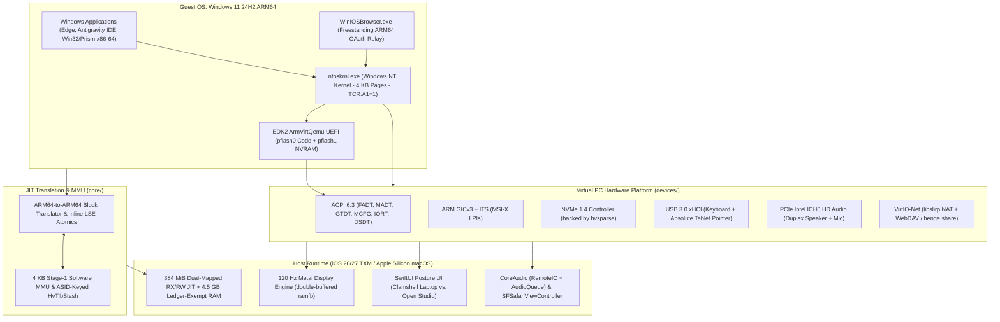

# Technical Analysis: WindowsiOS & Emulation Architecture

## Executive Summary

**WindowsiOS** is a high-performance virtual machine and dynamic binary translation engine capable of booting and interactively running unmodified **Microsoft Windows 11 24H2 ARM64 (Build 26100)** on non-jailbroken iOS devices (as well as Apple Silicon macOS). 

This document synthesizes our technical review, architectural breakdown, and discussion regarding how WindowsiOS operates, how it achieves near-native performance, why a JIT translator is required despite both guest and host sharing the AArch64 ISA, and how its architecture compares to user-space emulators like [`mini-qemu-arm64`](https://github.com/weidu-tpvision/mini-qemu-arm64).

---

## 1. The Core Engineering Challenge

Prior to WindowsiOS, running modern Windows 11 on stock iOS was considered unfeasible due to four distinct platform constraints:

1. **Deprecation of `Hypervisor.framework`:**  
   Starting in iOS 16.4, Apple disabled third-party access to EL2 hardware virtualization (`com.apple.developer.kernel.hypervisor`). Stock iOS apps cannot instantiate hardware virtual machines.
2. **Interpreter Performance Bottleneck:**  
   Emulators running in the App Store or via basic sideloading (such as UTM SE) rely on QEMU’s Tiny Code Interpreter (TCI). Instruction-by-instruction interpretation imposes a **5× to 10× performance penalty**, causing Windows 11 to take over 40 minutes to boot and rendering modern web browsers and IDEs unusable.
3. **Apple Trusted Execution Monitor (TXM) Restrictions:**  
   On iOS 26 and 27 devices (e.g., Apple A20 Pro), TXM hardware page-table signing restricts arbitrary `mprotect(..., PROT_EXEC)` / `MAP_JIT` allocations. Executable mappings above `0x7000000000` hang at the hardware level.
4. **Strict Memory Limits (Jetsam Watchdog):**  
   Stock iOS enforces an app memory limit of approximately 1.5 GB to 2.0 GB. A standard retail Windows 11 installation requires **4.0+ GB of RAM**, causing iOS to terminate the process immediately.

---

## 2. WindowsiOS Architectural Solution



### Key Technical Mechanisms

* **ARM64-to-ARM64 JIT Sandbox:**  
  Executes in iOS user space (EL0). Rather than interpreting opcodes, it compiles basic blocks of guest ARM64 code into host ARM64 machine code in a dual-mapped RX/RW region.
* **4 KB Software MMU on a 16 KB Host:**  
  Windows NT mandates 4 KB stage-1 translation granules (`HV_TLB_PAGE_BITS = 12`). The JIT injects lightweight, inlined TLB validation instructions for all memory operations (`LDR`/`STR`), utilizing large-block Bloom filters (`2 MB` and `1 GB`) to accelerate range invalidations (`TLBI`).
* **Windows NT ASID Dynamics:**  
  Windows sets `TCR_EL1.A1 = 1`, placing the process ASID in `TTBR1_EL1[63:48]` rather than `TTBR0_EL1`. During `KiSwapProcess`, Windows transiently drops to `ASID 0`. The MMU synthesizes an address-space key `(ASID << 48) | (TTBR0 & OA_MASK)` that filters out `ASID 0` to prevent stale user-mapping leaks across address space switches.
* **TXM Low-VA Reservation & Jetsam Exemption:**  
  Reserves a zero-fill region below `0x180000000` at Mach-O load time, deallocates it prior to debugserver allocation to secure low address space, and invokes `mach_memory_entry_ownership(..., LEDGER_NO_FOOTPRINT)` under `CS_DEBUGGED` to map **4.5 GB of guest RAM** outside the iOS Jetsam footprint.

---

## 3. Provisioning, Debloating, and Licensing

A critical point of discussion was how Windows 11 is acquired, installed, and customized:

1. **No Bundled Windows Image:**  
   WindowsiOS does not include a Windows 11 disk image in its git repository or app package due to Microsoft licensing restrictions and multi-gigabyte disk sizes.
2. **Evaluation & Unactivated Licensing:**  
   Microsoft permits evaluation downloads of Windows 11 ARM64 ESD/ISO images directly from its servers. An unactivated Windows 11 instance is fully functional (network, file system, compilers, browsers, and applications operate without artificial expiration), with only cosmetic restrictions (a desktop watermark and locked Personalization settings).
3. **Automated WinPE Provisioning Pipeline:**  
   The project’s Python toolchain (`scripts/provision_windows_arm64.py`) executes an unattended DISM extraction of Windows 11 Pro onto a virtual 32 GB NVMe disk, injecting an `unattend.xml` that bypasses TPM, Secure Boot, RAM minimums, and online Microsoft Account requirements.
4. **Offline Registry Surgery (`opt_hive_arm64.c`):**  
   Using a freestanding Win32 binary that acquires `SeRestorePrivilege` to override `TrustedInstaller` DACLs offline, the provisioning script disables Windows Defender, telemetry, Windows Search indexing, SysMain, and 35+ non-essential background services. This reduces idle memory usage from **4.0+ GB down to 1.46 GB**, allowing the OS to operate comfortably within the iPhone's allocated RAM.
5. **Sparse Packaging (`hvsparse`):**  
   Compresses the resulting 32 GB disk by skipping unallocated blocks into `windows11.hvsparse`, which is placed in `Documents/Machines/Win11/` on the iOS device.

---

## 4. Key Questions Explored

### Q1: Is it still an emulator?
**Yes, in the broad sense, but technically it is a Dynamic Binary Translator (JIT).**  
It emulates an entire PC platform (UEFI, ACPI, NVMe, USB, GICv3, Audio, Network), but executes guest CPU instructions by dynamically recompiling them into host machine code rather than running an instruction interpreter loop.

### Q2: Does it run at native hardware speed?
**It runs at near-native CPU speed (~60%–85% of bare metal), but not 100% native.**
* **Pure Compute (ALU/FPU/SIMD):** Instructions like `ADD`, `SUB`, `MUL`, `FADD`, and branch loops execute directly on physical Apple Silicon cores at native clock speed.
* **Memory Access:** Every `LDR` and `STR` incurs a 3-instruction software MMU check to translate 4 KB guest virtual addresses.
* **Graphics:** Operates via a virtual framebuffer (`ramfb`) rendered by Microsoft WARP software rasterization, presented at 120 Hz via Apple Metal. It does not provide hardware DirectX 12 GPU acceleration.

### Q3: Why is a JIT translator needed if both guest and host are ARM64?
Even though the instruction set architecture (ISA) is identical, the execution environments are incompatible:

| Constraint | Guest Requirement (Windows 11) | Host Reality (iOS) | JIT Solution |
| :--- | :--- | :--- | :--- |
| **Privilege Level** | Runs at **EL1 (Kernel)** with privileged instructions (`MSR`, `TLBI`, `ERET`, `WFI`) | Runs at **EL0 (User Space)** where EL1 instructions crash with `SIGILL` | Replaces privileged instructions with branch calls to C emulation handlers. |
| **Paging Granule** | Uses **4 KB virtual pages** | Hardware strictly enforces **16 KB pages** | Inlines software TLB checks on all memory loads/stores. |
| **Register ABI** | Uses register **`x18`** (TEB pointer) and guest `SP` | Host reserves **`x18`** for Darwin kernel and owns host `SP` | Remaps guest `x18` and `SP` into an in-memory `HvCpu` structure. |
| **Hardware I/O** | Writes to physical MMIO addresses (e.g. `0x08000000`) | No physical chips mapped to those addresses | Intercepts MMIO addresses and updates virtual hardware devices in C. |

---

## 5. Comparative Analysis: `mini-qemu-arm64` vs. `WindowsiOS`

A major insight from our discussion was the architectural connection to [`weidu-tpvision/mini-qemu-arm64`](https://github.com/weidu-tpvision/mini-qemu-arm64):

```
+---------------------------------------------------------------------------------------------------+
|                                 Spectrum of Emulation & Translation                               |
+---------------------------------------------------------------------------------------------------+
|  mini-qemu-arm64                                              WindowsiOS                          |
|  (User-space / Educational)                                   (Full-System / Bare-Metal OS)       |
|                                                                                                   |
|  - Scope: Linux ELF User Binaries (fib.elf, plasma.elf)       - Scope: Full OS (UEFI + Windows 11)|
|  - ISA: Cross-ISA (ARM64 -> x86-64 NASM & JS)                - ISA: Same-ISA (ARM64 -> ARM64)    |
|  - Engine: Software Interpreter + Static AOT                 - Engine: Dynamic Runtime JIT Block |
|  - Paging: Simulated Flat/Sparse 4 KB User RAM               - Paging: 4-Level Stage-1 MMU + ASID|
|  - Trapping: SVC #0 Syscalls (sys_write, sys_mmap)           - Trapping: EL1 Privileged CPU Ops  |
|  - Peripherals: MMIO VRAM (0x800000), Audio PSG (0x860000)   - Peripherals: ACPI 6.3, GICv3 ITS,  |
|                                                                 NVMe 1.4, xHCI, Intel ICH6 HDA    |
+---------------------------------------------------------------------------------------------------+
```

### Architectural Parallels

1. **Decoding & IR Lowering:**  
   Both engines parse 32-bit AArch64 opcodes according to ARM Architecture Reference Manual bitfield specifications. While `mini-qemu-arm64` translates them to x86 assembly or JavaScript ASTs, `WindowsiOS` preserves native instructions and instruments only memory and privileged barriers.
2. **Memory Virtualization:**  
   `mini-qemu-arm64` implements user-space dynamic allocation through simulated `sys_brk` and `sys_mmap`. `WindowsiOS` implements the full VMSAv8-64 stage-1 hardware MMU specification with translation table walks across 4 levels.
3. **Peripheral I/O:**  
   `mini-qemu-arm64` models custom educational MMIO devices (a 320×240 framebuffer at `0x00800000` and a chiptune PSG audio synthesizer at `0x00860000`). `WindowsiOS` models industry-standard PC interfaces (PCIe configuration space, NVMe admin/IO submission queues, and Intel High Definition Audio CORB/RIRB ring buffers) to satisfy standard Windows WHQL inbox drivers.

---

## 6. Conclusion

WindowsiOS demonstrates how dynamic binary translation can serve as a **lightweight, instruction-level hypervisor substitute**. By taking advantage of ISA symmetry (ARM64 on ARM64) while selectively virtualizing only privileged operations, memory translation, and hardware registers, it achieves the performance required to run an unmodified, multi-process desktop operating system entirely within an unprivileged mobile sandbox.
